# OA预立项自动化反馈

## 一、可以改进的地方

1.1、CN预审案件答复审查意见的期限需要调整：即邮件里写答复期限：几个工作日的，要从官文发文日起算。例如下述截图中：第一次审查意见的期限：自发文日起计算10个工作日，生成的答复期限，是从发文日第二日开始计算的。

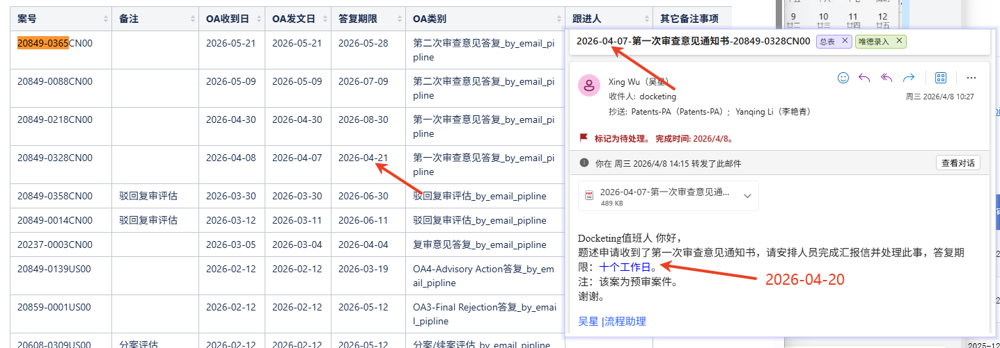

1.2、官文和邮件附件还没有上传：IT反馈：官文和邮件附件并没上传，需要的话可以增加

1.3、计划送审日的周期需要调整：

部分答复类型计划送审日可能需要调整，比如下述截图中红框的案子，计划送审日应该是是发文日+30，但这里设置的是+45天；还有US的FOA，是发文日+14天，但这里面是+30天，可能需要调整下；

评估类的可能也要调整，但评估类的一般都是需要客户指示后答复，AI导入的期限不准的话，需后续实际立项手动改

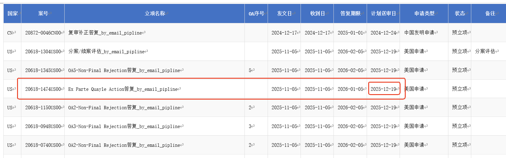

1.4、显示的页面与之前旧的页面不一样，新的测试页面中，目前只能审核（项目名称、官方期限、资料链接、申请类型）这几项，旧的页面中需要填写的比较多，见下述截图的红框部分，填写后点击保存会生成资料链接；

测试页面中，资料链接没有，无法跳转到该案wiki页面----IT已根据反馈优化

测试用的页面：预立项处理页面http://10.10.70.88:8080/manage/pro/set

旧的页面：OA预处理页面http://10.10.70.88:8080/manage/newOA/index

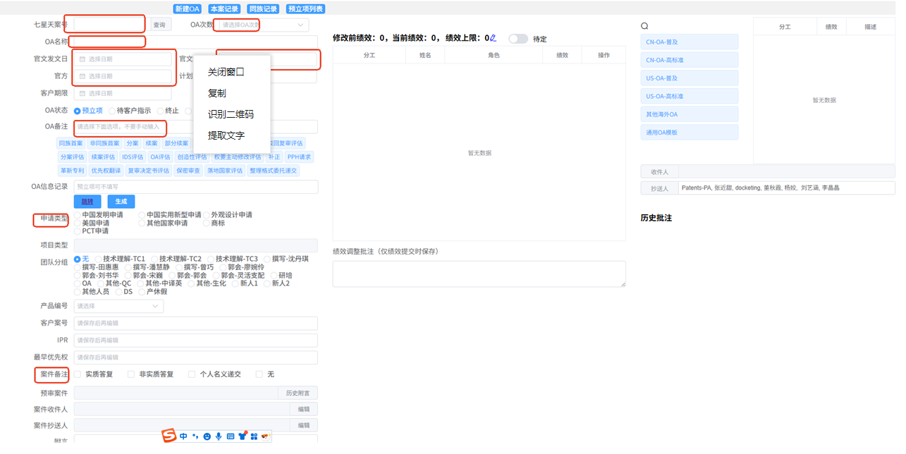

1.5、wiki-OA信息登记表页面的反馈

下述截图中红框这些都需要生成，案件标题、公开号（如有）、分类号（如有）、谷歌公开链接（如有）、OA收文日、期限，官文中的对比文件及链接（如果是专利文献，放谷歌链接、如果是非专利文献，如学术文章，放文章本身）

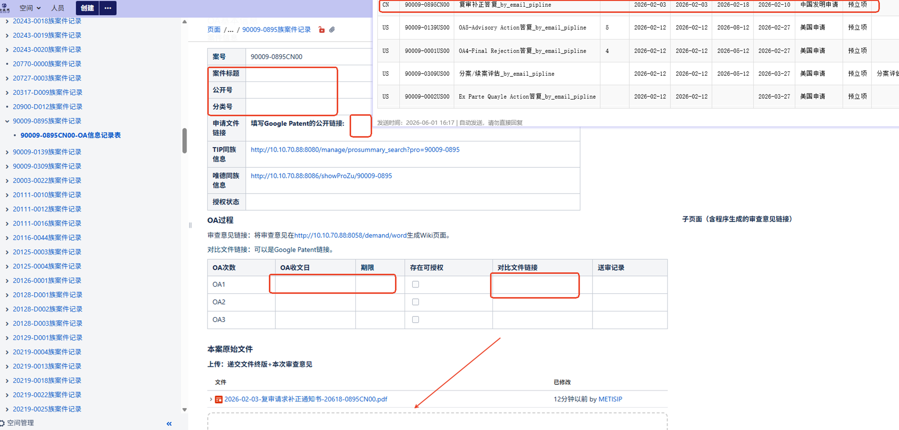

http://10.10.70.88:8058/demand/word 官文还需要在这个链接里读取一下，生成官文的Wiki页面

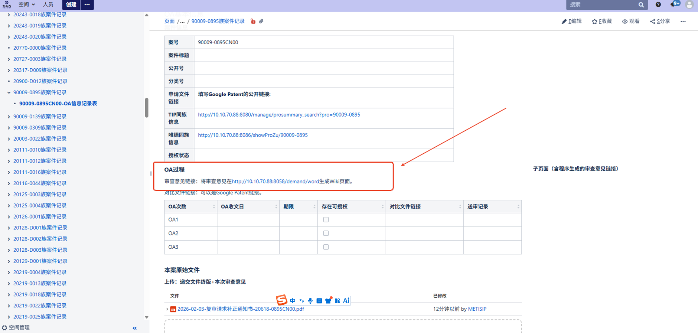

## 二、效率和便捷性

2.1、自动登记OA案件记录，可避免漏案件

2.2、预立项效率，待改进后试用和反馈

# OA汇报信自动化反馈

## 一、可以改进的地方

1.1、官文附件上命名多了一串数字，案号只需要保留我司命名规则部分-----IT已根据反馈优化

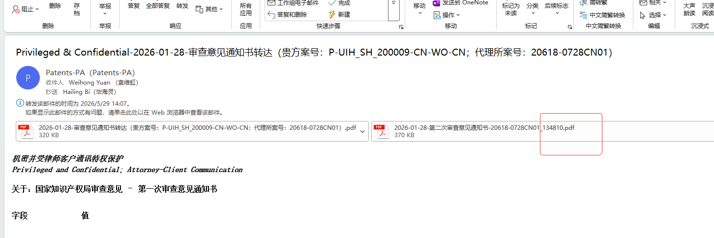

1.2、页面上不显示官文和邮件附件，得发出来才能看到---IT已根据反馈优化，新的界面上已有附件

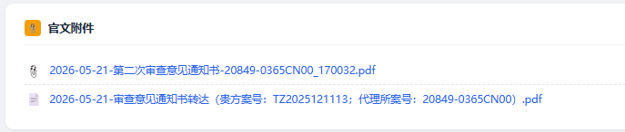

1.3、汇报信正文表格上有“值”、“字段”三个字，需要删除---IT已根据反馈优化

1.4、委托方案号的名称和邮件正文中不一致，需统一；需识别客户案号；需识别唯德上的案件名称，而不是提案名称；具体第几次审查意见需识别准确---IT已根据反馈优化

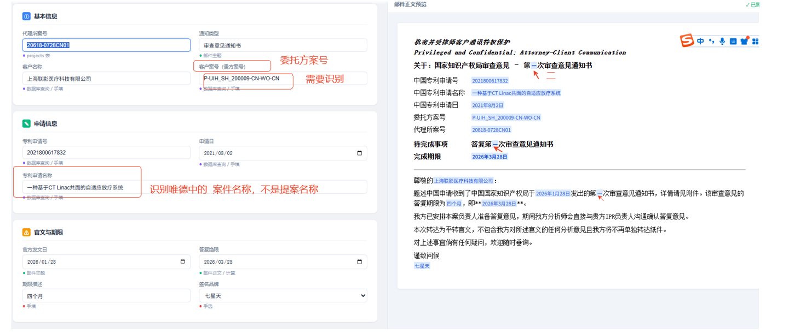

1.5、汇报信正文格式，需保留原汇报信的格式，因当前只优化了OA相关的汇报信，其他类型汇报信还没有自动化，发给客户的形式建议一致，---IT已根据反馈优化

之前的自动化格式如下：

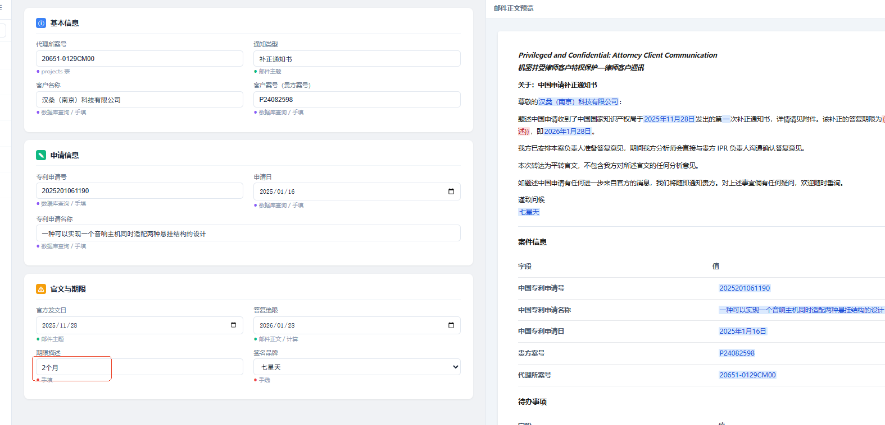

更新后的格式：

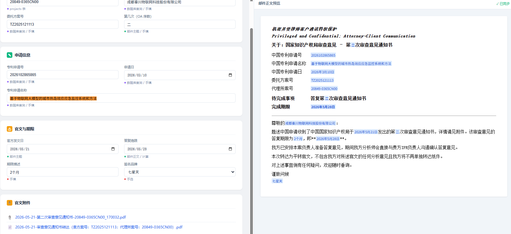

1.6、答复期限没有自动计算，如下述案件期限是发文日+2个月，但刷新后答复期限没有变动---后续优化

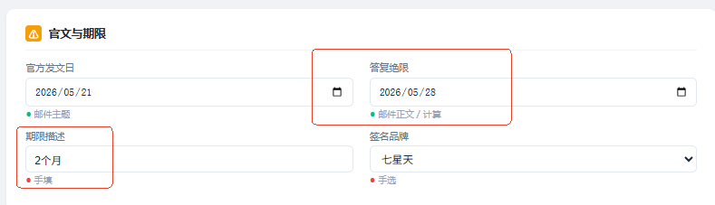

1.7、指示期限的字段没有填写的地方---后续优化

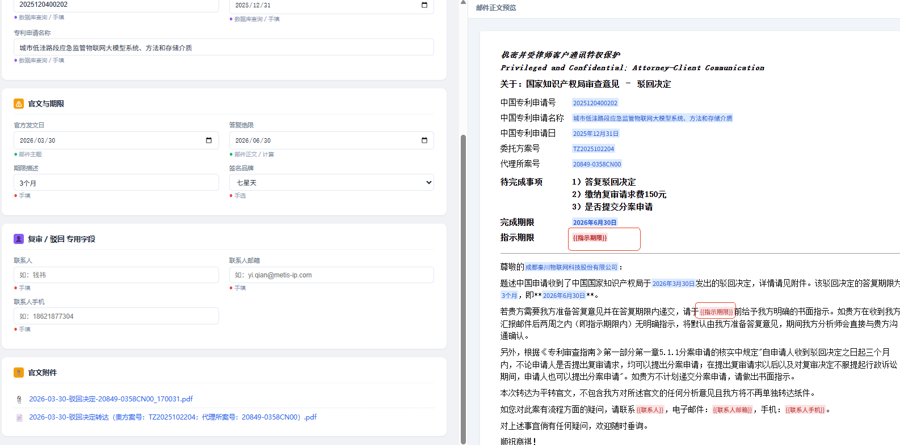

1.8、唯德系统上建立了汇报信相关的客户要求，是否可以在汇报信生成的界面上显示这个要求

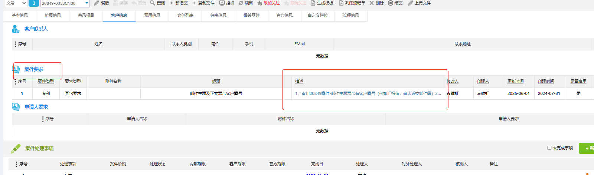

## 二、效率和便捷性

待进一步试用和优化
